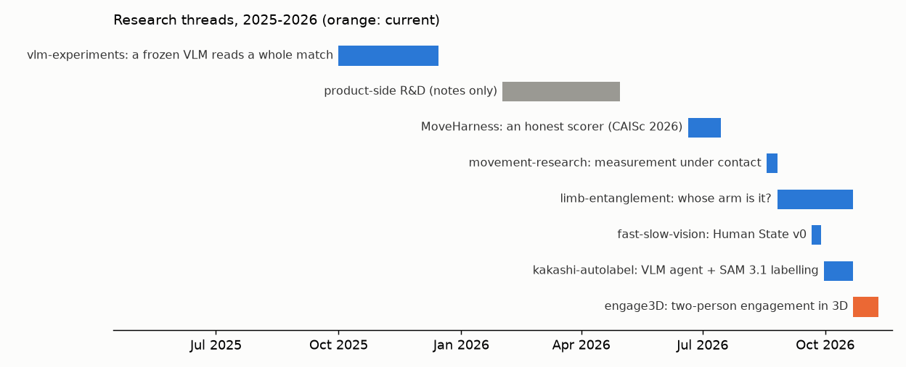

# Research, 2025–2026 — Dhruva Chakravarthi

Index of my research on **understanding human movement and engagement from ordinary video**: where people are, how
they touch, whose limb is whose, and how far a model's description can be trusted. Grappling (BJJ, MMA) is the test
case because it is the hardest: two bodies in constant contact. Each thread is its own repository with its experiments,
code, figures and every negative result.

| Thread | When | Question | Where it ended |
|---|---|---|---|
| [vlm-experiments](https://github.com/dhruvinci/vlm-experiments) | Oct–Dec 2025 | Can a frozen VLM (Gemini) produce a correct timeline of a whole match? | It finds *where* (span overlap ~0.7), not *what* (position macro-F1 ≤ 0.14) |
| [product-side R&D](notes/product-rnd.md) | Feb–Apr 2026 | Knowledge graph, striking pipeline, a fast/slow design | Methods notes only; unvalidated |
| [MoveHarness](https://github.com/dhruvinci/moveharness) | Jul 2026 | An honest, deterministic scorer for VLM movement understanding (CAISc 2026 paper) | Re-scores every stored output without inference |
| [movement-research](https://github.com/dhruvinci/movement-research) | Aug 2026 | Can single-camera measurement be trusted under contact, with error bars? | The camera's lens is the biggest lever (60.5 -> 8.4 cm); separating two people in contact stays unsolved |
| [limb-entanglement](https://github.com/dhruvinci/limb-entanglement) | Aug–Oct 2026 | Whose arm is it, when two people are tangled? | VLM language states add nothing (0 of 27 trapped-arm cells); a tracker gives a modest blind-confirmed gain |
| [fast-slow-vision](https://github.com/dhruvinci/fast-slow-vision) | Sep 2026 | Can a small fast model describe people well enough for a slow one to reason on? | Not yet: controls fail (answer follows the letter, not the person); a DINOv2 posture readout holds up |
| [kakashi-autolabel](https://github.com/dhruvinci/kakashi-autolabel) | Sep–Oct 2026 | Can a VLM agent plus SAM 3.1 label combat video at scale? | 485,028 person masks over 1,526 intervals; human review finds 52-70% fully right, below every AI audit |
| [engage3d](https://github.com/dhruvinci/engage3d) | Oct 2026– | Measure two-person engagement in 3D from one camera | Distance error between the two athletes 11.2 -> 3.2 cm on held-out sequences; limbs inside tangles remain |

## Models and data
- **Models (public, Hugging Face):** [`0xdhruva/engage3d-placement-v1`](https://huggingface.co/0xdhruva/engage3d-placement-v1).
- **Datasets (private, available on request):** MoveBench v0; labels for Kakashi-labelled combat-sports videos from
  public sources (catalogue, person masks, positions, events, technique segments; no media).
- Hugging Face profile: [0xdhruva](https://huggingface.co/0xdhruva).

## How the work is run
- Experiments are pre-registered where possible: pass criteria and falsifiers are written before the run (and, from
  now on, committed to git before it), and failures are reported against them.
- Retractions are kept next to what replaced them.
- AI-made labels are called AI references, never ground truth; only human review counts as ground truth.
- No private footage is shown or redistributed; results measured only on private footage are withheld.

More: [dhruva.life](https://dhruva.life). Text: CC BY 4.0. Each repository states its own licences.
